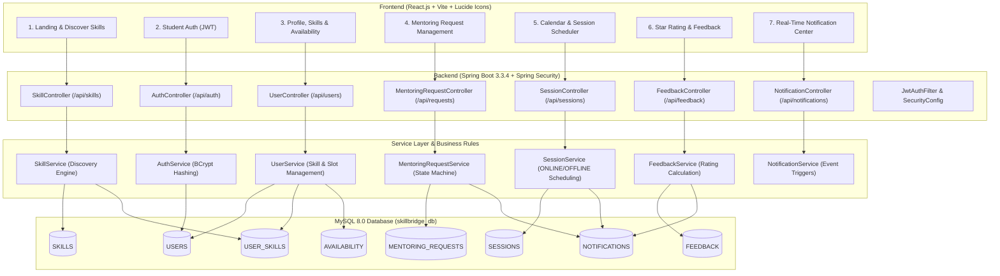

# SkillBridge
Peer-to-Peer Skill Exchange and Micro-Mentoring Platform

# SkillBridge — Peer-to-Peer Skill Exchange & Micro-Mentoring Platform

SkillBridge is an end-to-end web platform designed to connect students who want to learn a skill with students who can teach that skill through focused micro-mentoring sessions. 

---

## 🗺️ Architectural Map & Data Flow



---

## 🗄️ Relational Database Schema & Entities

The platform implements 8 core relational tables in MySQL with primary keys, foreign key constraints, timestamps, and indexes:

1. **`USERS`**: `user_id` (PK), `name`, `email` (UNIQUE), `password` (BCrypt hash), `college`, `department`, `academic_year`, `bio`, `avatar_url`, `role`, `created_at`.
2. **`SKILLS`**: `skill_id` (PK), `skill_name` (UNIQUE), `category`, `description`.
3. **`USER_SKILLS`**: `user_skill_id` (PK), `user_id` (FK), `skill_id` (FK), `proficiency` (`BEGINNER`, `INTERMEDIATE`, `ADVANCED`, `EXPERT`), `type` (`TEACH`, `LEARN`, `BOTH`), `experience_details`. Unique constraint on `(user_id, skill_id, type)`.
4. **`AVAILABILITY`**: `availability_id` (PK), `user_id` (FK), `day_of_week`, `start_time`, `end_time`.
5. **`MENTORING_REQUESTS`**: `request_id` (PK), `learner_id` (FK), `mentor_id` (FK), `skill_id` (FK), `status` (`PENDING`, `ACCEPTED`, `REJECTED`, `CANCELLED`, `COMPLETED`), `message`, `preferred_date_time`, timestamps.
6. **`SESSIONS`**: `session_id` (PK), `request_id` (FK, UNIQUE), `scheduled_at`, `duration`, `mode` (`ONLINE`, `OFFLINE`), `meeting_link_or_location`, `status` (`SCHEDULED`, `COMPLETED`, `CANCELLED`).
7. **`FEEDBACK`**: `feedback_id` (PK), `session_id` (FK), `reviewer_id` (FK), `target_user_id` (FK), `rating` (1–5), `comment`, `created_at`.
8. **`NOTIFICATIONS`**: `notification_id` (PK), `user_id` (FK), `title`, `message`, `is_read`, `created_at`.

---

## 💻 Tech Stack Summary

| Layer | Technology | Purpose |
|---|---|---|
| **Frontend** | React 18, Vite, Lucide Icons, Modern CSS | Component-based, responsive UI supporting all 15 screens |
| **Backend** | Java 17+, Spring Boot 3.3.4 | REST API, Business logic, Validation, Security filter chain |
| **Security** | Spring Security 6, JJWT 0.11.5, BCrypt | Stateless JWT Bearer token authentication & authorization |
| **Persistence** | Spring Data JPA, Hibernate, MySQL Driver | Object-relational mapping, custom JPQL queries, automated DDL |
| **Database** | MySQL 8.0 Community Server | ACID compliant relational storage for users, sessions, and reviews |
| **Build Tools** | Maven 3.9+ & Node.js / npm | Backend compilation and frontend bundling |

---

## 🚀 Step-by-Step Setup Instructions (Windows)

### 1. Prerequisites Check
Ensure the following are installed:
- **Java**: JDK 17, 21, or 24 (`java -version`)
- **Maven**: 3.8+ (`mvn -version`)
- **Node.js**: v18+ (`node -v` and `npm -v`)
- **MySQL**: MySQL Server 8.0 running on port 3306

### 2. Configure MySQL Database
Open MySQL command line or MySQL Workbench:
```sql
CREATE DATABASE IF NOT EXISTS skillbridge_db;
```
Configure your database username & password in `backend/src/main/resources/application.properties` (defaults to `root` / `root`):
```properties
spring.datasource.url=jdbc:mysql://localhost:3306/skillbridge_db?createDatabaseIfNotExist=true&useSSL=false&serverTimezone=UTC&allowPublicKeyRetrieval=true
spring.datasource.username=root
spring.datasource.password=root
```
*(Tip: You can pass `-Dspring.datasource.password=YOUR_PASSWORD` when running Maven).*

### 3. Run the Spring Boot Backend
Open a terminal in `SkillBridge/backend`:
```powershell
cd c:\Users\hanum\OneDrive\Desktop\SkillBridge\backend
mvn clean spring-boot:run
```
The backend starts at `http://localhost:8080`.

### 4. Run the React Frontend
Open another terminal in `SkillBridge/frontend`:
```powershell
cd c:\Users\hanum\OneDrive\Desktop\SkillBridge\frontend
npm install
npm run dev
```
Open your browser at `http://localhost:5173`.

---

## 🔑 Pre-Configured Demo Accounts

For instant testing and evaluation, the database pre-seeds these students (Password: `password123`):

1. **Aarav Sharma**
   - **Email**: `aarav@example.com`
   - **Teaches**: Java & Spring Boot (ADVANCED)
   - **Learning**: UI/UX Design & Figma (BEGINNER)
2. **Priya Patel**
   - **Email**: `priya@example.com`
   - **Teaches**: UI/UX Design & Figma (EXPERT)
   - **Learning**: Java & Spring Boot (INTERMEDIATE)
3. **Rohan Verma**
   - **Email**: `rohan@example.com`
   - **Teaches**: Python & Machine Learning (ADVANCED)
   - **Learning**: React.js & Frontend (BEGINNER)

*Quick one-click login buttons for all 3 demo accounts are provided directly on the Login page!*

---

## 📋 Complete REST API Documentation

### Authentication (`/api/auth`)
- `POST /api/auth/register` — Register a student with name, email, password, college, department, academic year.
- `POST /api/auth/login` — Login with credentials and receive a JWT token.

### User Profiles & Skills (`/api/users`)
- `GET /api/users/{id}` — Retrieve full student profile, skills, average rating, reviews, and availability.
- `GET /api/users/me` — Retrieve the currently authenticated user's profile.
- `PUT /api/users/{id}` — Update bio, college, department, year, and avatar URL.
- `POST /api/users/{id}/skills` — Add a skill to teach or learn with proficiency.
- `DELETE /api/users/{id}/skills/{userSkillId}` — Remove a user skill.
- `PUT /api/users/{id}/availability` — Update weekly availability time slots.

### Skills & Discovery (`/api/skills`)
- `GET /api/skills` — List all registered skills across categories.
- `POST /api/skills` — Propose/create a new skill.
- `GET /api/skills/mentors` — Search peer mentors by skill name, category, and proficiency level.

### Mentoring Requests (`/api/requests`)
- `POST /api/requests` — Send a micro-mentoring request to a peer mentor.
- `GET /api/requests/my` — Get all requests sent (as learner) and received (as mentor).
- `PUT /api/requests/{id}/accept` — Accept a pending request (mentor only).
- `PUT /api/requests/{id}/reject` — Decline a request (mentor only).
- `PUT /api/requests/{id}/cancel` — Cancel a request (learner only).

### Sessions & Calendar (`/api/sessions`)
- `POST /api/sessions` — Schedule session details (date/time, duration, ONLINE/OFFLINE mode, meeting link or room).
- `GET /api/sessions/my` — Get all upcoming and completed sessions.
- `PUT /api/sessions/{id}/complete` — Mark a session completed to unlock feedback.

### Feedback & Ratings (`/api/feedback`)
- `POST /api/feedback` — Submit a 1–5 star rating and comment after session completion.
- `GET /api/feedback/user/{userId}` — Retrieve all feedback reviews for a student.
- `GET /api/feedback/user/{userId}/average` — Get calculated average star rating.

### Notifications (`/api/notifications`)
- `GET /api/notifications` — List all notifications.
- `GET /api/notifications/unread-count` — Count unread notifications.
- `PUT /api/notifications/{id}/read` — Mark an individual notification as read.
- `PUT /api/notifications/read-all` — Mark all notifications as read.

---

## 🧪 Postman API Testing Collection
Import [`SkillBridge_Postman_Collection.json`](SkillBridge_Postman_Collection.json) into Postman to run end-to-end automated API requests with preconfigured JSON payloads.
